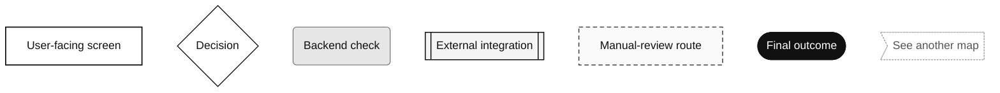
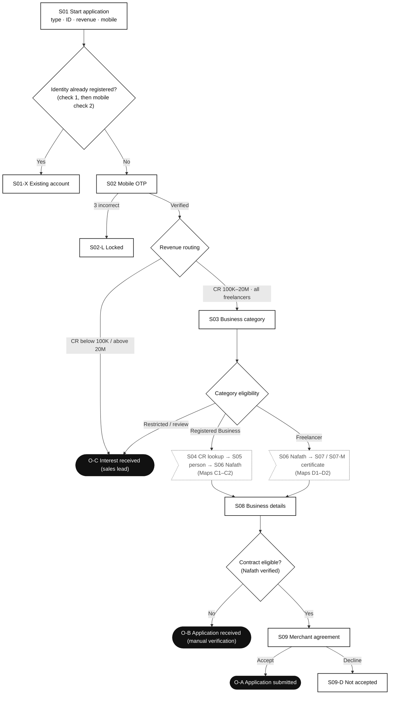
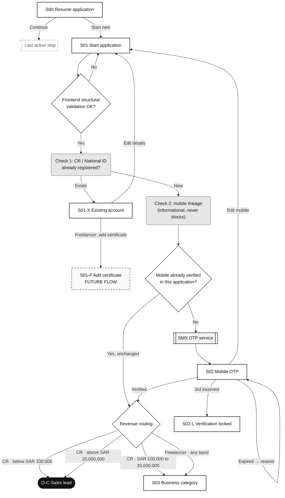
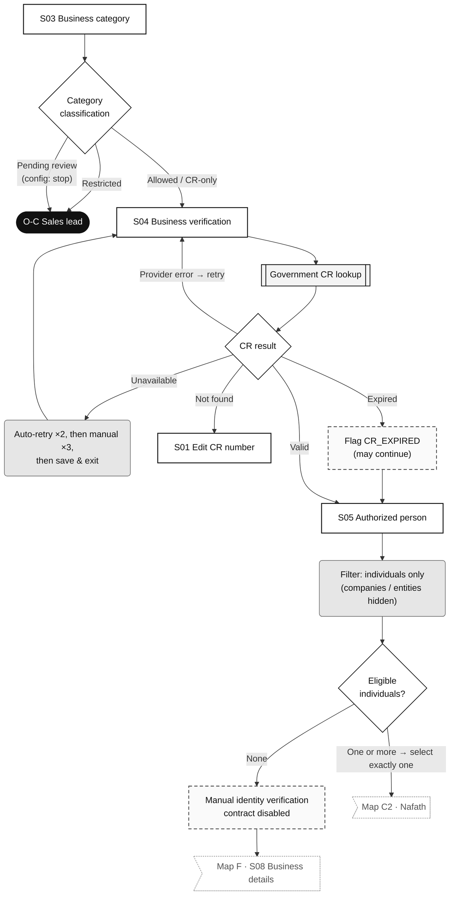
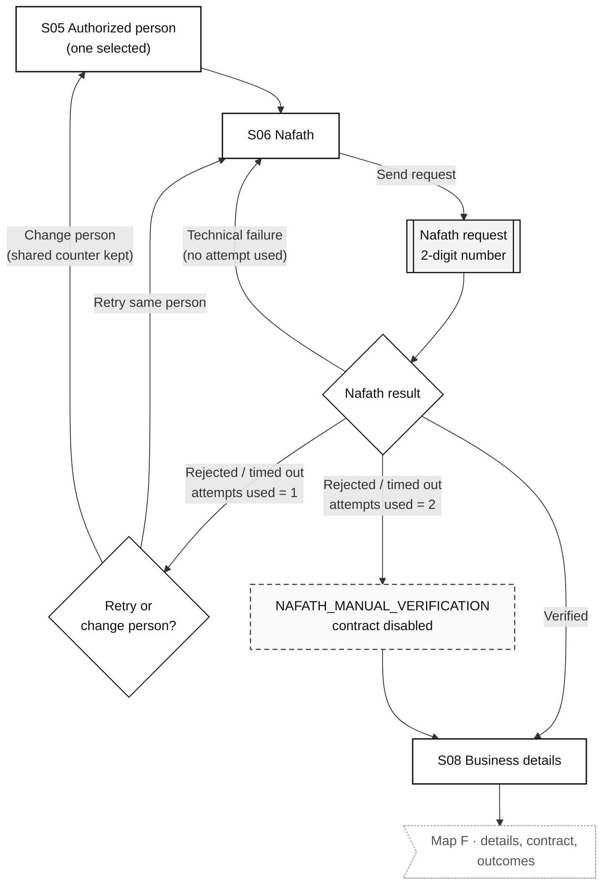
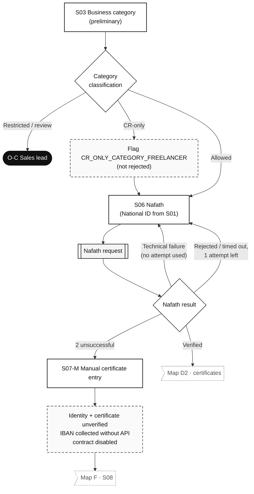
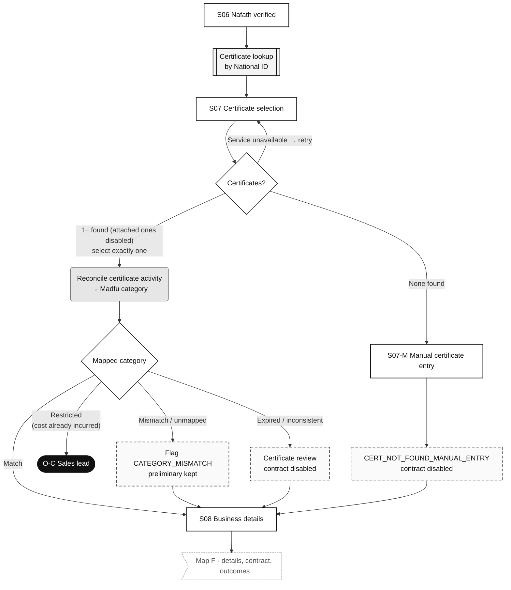
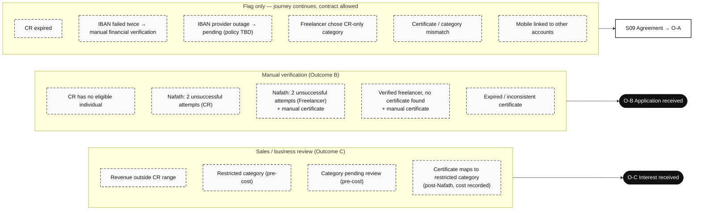
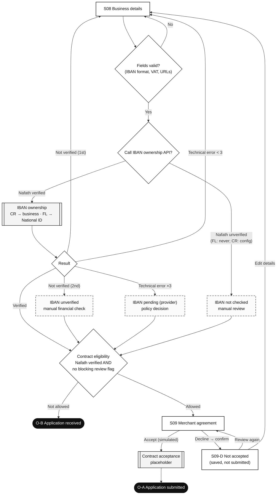

# Journey decision maps

> Generated by `npm run docs` from the prototype source (`src/`). Do not edit by hand.

Interactive versions (screen nodes link to the screen gallery): https://wearemishkat.github.io/madfu-onboarding-wireframes/#/map/A

Visual distinctions: **screen** (white rectangle) · **decision** (diamond) · **backend check** (grey rounded) · **external integration** (double-bordered) · **manual-review route** (dashed) · **final outcome** (black pill) · **continuation reference** (flag shape → another map).

## Legend

Visual distinctions used in every map.

## Map A — Master overview

End-to-end routing for both applicant types, with continuation references to detailed maps.

## Map B — Entry, duplicate checks, OTP and revenue routing

Shared steps up to eligibility routing. Identity check always runs before the mobile check.

## Map C1 — Registered Business: category, CR lookup, authorized person

Category screening before paid calls, government CR verification outcomes, individuals-only person selection.

## Map C2 — Registered Business: Nafath attempts

Two Nafath attempts per application, shared across authorized individuals.

## Map D1 — Freelancer: category and Nafath

Preliminary category screening and Nafath on the National ID entered at the start.

## Map D2 — Freelancer: certificates and reconciliation

Certificate retrieval, single selection and reconciliation with the preliminary Madfu category.

## Map E — Manual-review routes

Every route that ends in a lead, a manual verification, or a flag-only review.

## Map F — Business details, contract and outcomes

IBAN verification, contract eligibility matrix and final outcomes.

